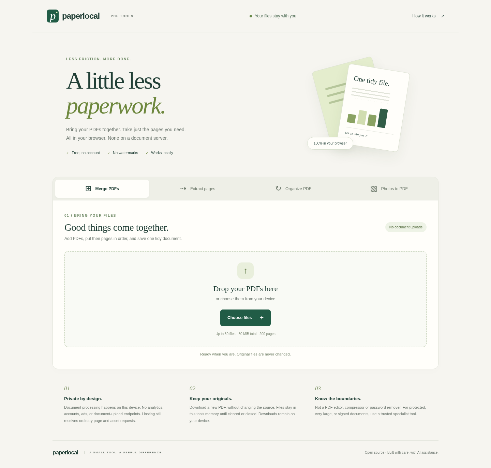

# Paperlocal PDF

### A little less paperwork.

An original, local-first PDF workspace: merge documents, extract pages, reorder and rotate them, or turn JPG/PNG photos into a PDF. No account, watermark, document-upload endpoint, or runtime CDN dependency.



## Run it in two steps

1. Download and extract the source ZIP, or clone this repository.
2. Open a terminal in the project folder and run:

```sh
python -m http.server 8080 --bind 127.0.0.1
```

Open **http://127.0.0.1:8080** in a modern browser. On Windows, use `py -m http.server 8080 --bind 127.0.0.1` if `python` is unavailable. Python 3 is only a static file server; it never processes your documents. There is no npm install or build step.

Use HTTP, not double-clicked `file://`: browser module and worker restrictions prevent reliable local-file opening. All runtime dependencies are included in `vendor/`. With a local server, no internet is needed. A remotely hosted copy still needs its page/assets downloaded; there is no service worker or promise of offline reload caching.

## What works

| Tool | Workflow |
| --- | --- |
| Merge PDFs | Add multiple PDFs, preview pages, choose their output order and download one PDF. |
| Extract pages | Add one PDF; use a range such as `3, 1-2`, or page checkboxes; download one new PDF. Repeat for separate extracts. |
| Organize PDF | Move pages earlier/later, rotate clockwise in 90° steps, and omit unwanted pages. |
| Photos to PDF | Add JPG/PNG images, reorder/rotate and export as auto-oriented A4 with margins or image-sized pages. |

The range field refers to the **current displayed order**. Each page may appear once; duplicate and backward ranges are rejected. Move buttons are keyboard operable; they do not require drag-and-drop. Rotation labels show the added rotation, on top of any rotation already in a source PDF. Photo image-size output uses 96 pixels/inch, not embedded DPI metadata. Photos are decoded and re-encoded in the browser; JPEG quality is 0.95 and original camera metadata is not intentionally copied.

### Bounded for ordinary documents

- Up to 30 files, 50 MiB combined input and 200 pages in a workspace.
- Photos: at most 25 megapixels each and 50 megapixels combined.
- Empty, malformed, wrong-type and encrypted/password-protected PDFs receive clear errors. An invalid batch is not partially added.
- Originals are never overwritten. Clear files or close the tab to discard working state; downloaded files remain on your device.

These limits are guardrails, not guarantees against browser memory pressure. Complex PDFs or modest phones may need much smaller inputs.

## Privacy, honestly

Processing uses browser memory, local canvas, bundled PDF.js previews and bundled pdf-lib output. The app has no analytics, ads, accounts, document storage, or upload API. Filename display uses text nodes. Its Content Security Policy restricts scripts and connections to its own origin. Browser tests observed only same-origin static GET requests while using all four tools.

This is **not** a security certification, a PDF sanitizer, redaction tool or protection against a compromised browser/extension/host. Copies of embedded content may survive page copying. Treat untrusted PDFs carefully, use a trusted local copy for private documents and review every output before sharing. See [SECURITY.md](SECURITY.md).

## Boundaries

- No PDF compression, OCR, text editing, Office conversion, password removal, signing or real-time collaboration.
- No preservation guarantee for forms, digital signatures, bookmarks, annotations, attachments, layers, links, accessibility tags or other interactive/document-level features. Page copying may omit some or retain others. Do not use it for redaction.
- Uncommon fonts, CJK/CMaps, JPEG2000 and malformed input may not preview correctly. A failed preview is labelled; inspect the downloaded document with a trusted viewer. PDFs are not rasterized when pages are copied.
- Tested on Linux Chromium at desktop and 390px mobile viewport. Physical iPhone/Android devices, Safari and Firefox have not been tested. Accessibility affordances are implemented, not independently certified.
- This source is ready to run locally or serve as static files, but no public deployment is included.

## Tests

The runtime needs no Node or Python libraries. Development checks need Node 20+; the browser suite also uses Python/uv and Chromium.

```sh
node --test tests/core.test.mjs
# 40 deterministic core/output tests

uv run tests/browser_check.py
# real browser workflows + independent pypdf output inspection
```

The browser suite uses `CHROMIUM_PATH`, a system `chromium`/`chromium-browser`, or Playwright's installed Chromium. If none is installed:

```sh
uv run --with playwright==1.55.0 playwright install chromium
```

Linux may need Playwright's documented system dependencies. Tests generate synthetic fixtures under `tests/fixtures/` and outputs under `.test-output/`, not user documents. [Validation details](docs/VALIDATION.md) describe the actual tested scope.

## Structure

- `index.html`, `style.css` — responsive original visual design.
- `src/app.js` — file intake, state, thumbnails, UI and download behavior.
- `src/core.js` — validation, range selection and real PDF export.
- `vendor/` — pinned runtime libraries and their original licenses.
- `tests/` — core and real-browser tests.
- `docs/screenshots/` — screenshots of the running build, not mockups.

## Credits and license

Developed for Raj's portfolio with AI assistance from Wabi. The application and documentation are MIT-licensed; this is not a claim of professional client work or independent authorship. Original CSS artwork; no copied commercial brand assets. Third-party components retain their licenses: see [THIRD_PARTY_NOTICES.md](THIRD_PARTY_NOTICES.md). Useful improvements and reproducible bug reports are welcome; never put private documents in an issue.

## Live demo

Open the browser version at <https://rajtiwari3594.github.io/paperlocal-pdf/>. It runs entirely in the browser; each visitor's documents or study data stay in that browser and are not synchronized to an account.
